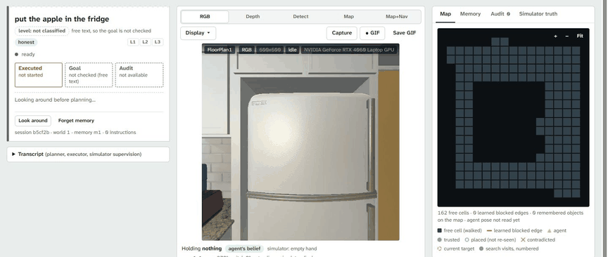
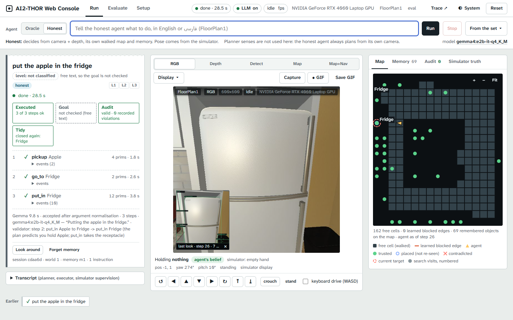
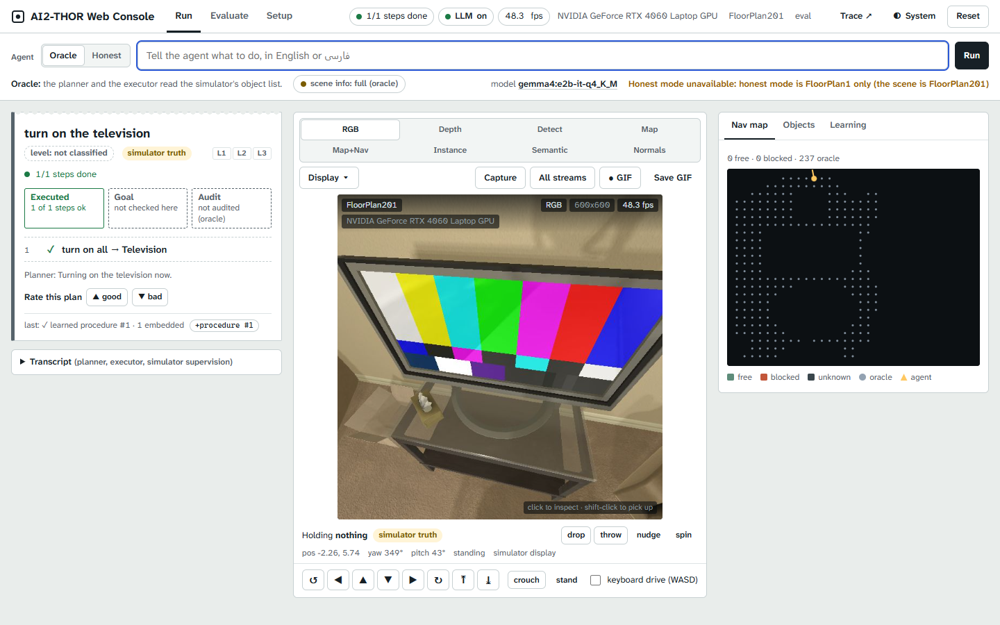
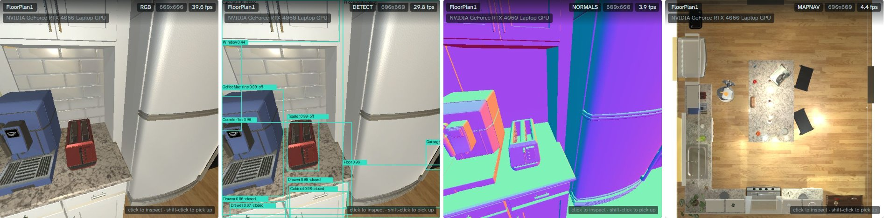
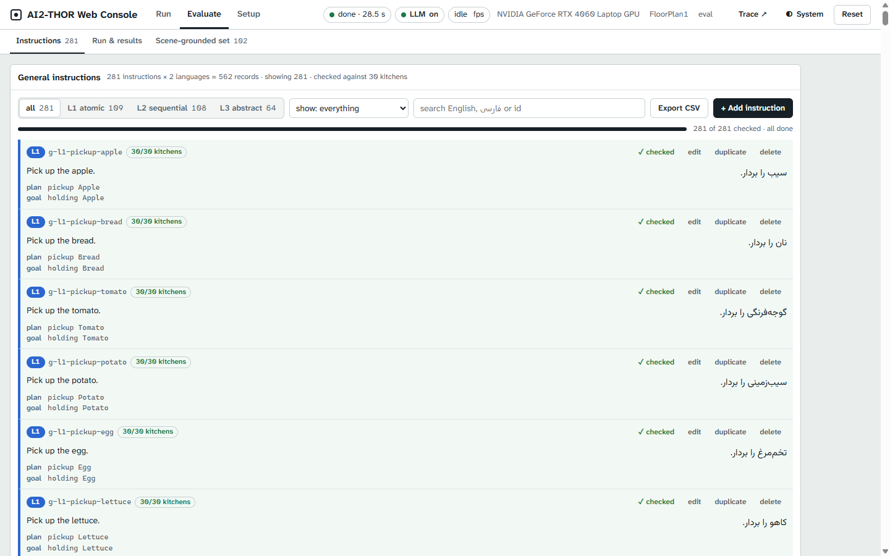
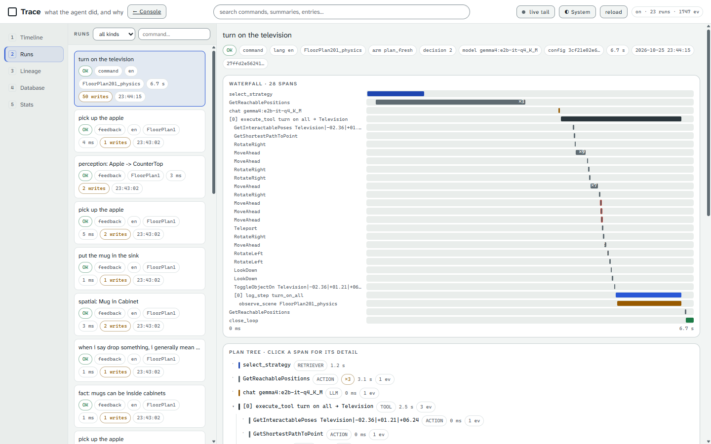
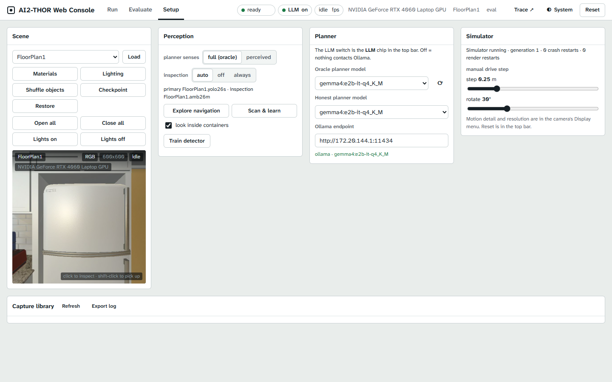
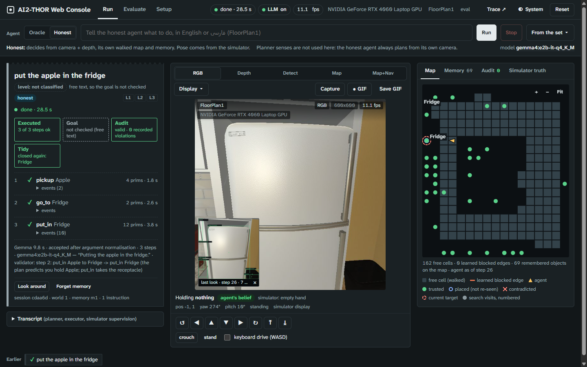

# AI2-THOR Web Console

A browser console and Python toolkit for AI2-THOR 5.0.0 (iTHOR). Drive the simulator, give an agent instructions in English or Persian, watch what it perceives and plans, evaluate it, and inspect its memory writes. The console supports all 120 iTHOR rooms. It was extracted from [MISE](https://github.com/ArashNasrEsfahani/MISE), my MSc research project at the University of Tehran. This project is not affiliated with the Allen Institute for AI.



A 26-second recording in FloorPlan1: the honest agent looks around, plans with Gemma 4, picks up the apple, walks to the fridge, opens it, puts the apple inside, and closes it.

## What you get

- A browser interface for instructions, manual driving, sensor views, captures, and GIF recording.
- Oracle mode with simulator object information, and honest mode with camera, depth, a walked map, memory, and audited simulator access.
- Three command levels: atomic actions (L1), ordered sequences (L2), and abstract goals (L3).
- An Ollama planner, retrieval, human plan ratings, and a loop that records procedures, lessons, and facts.
- Editable bilingual instructions, evaluation metrics, and a trace viewer that connects memory writes to their causes.
- Released detectors and walked maps for FloorPlan1, FloorPlan15, and FloorPlan17.

The scene picker groups kitchens, living rooms, bedrooms, and bathrooms. Honest mode in this console release runs in **FloorPlan1**. It needs a walked map and trained detectors.

## Screenshots



The apple task has three successful steps, a valid audit with zero violations, and a record that the fridge was closed again. The map shows the agent's own walk and remembered objects.



Oracle mode in FloorPlan201 after “turn on the television.” The TV displays a colour test pattern, and the console records a learned and embedded procedure.



RGB, Detect, surface Normals, and Map+Nav views in FloorPlan1. Detector labels include object confidence and states such as off and closed.



The Evaluate tab contains 281 bilingual instructions: 109 L1, 108 L2, and 64 L3. Each has English and Persian text, a reference plan, and a goal. Controls support checking, editing, duplication, deletion, search, and CSV export.



The television run contains 28 spans, including strategy selection, an LLM call, a tool call, simulator actions, and loop closure. The viewer also shows the plan tree.



Setup groups scene controls, perception, planner settings, simulator health and manual drive settings, and the capture library.



The same honest run in the dark theme. The theme follows the system, and the header toggle switches it.

## Quick start

The simulator requires Linux with an X display, or Windows 11 with WSL2 and WSLg. Use Python 3.10. Setup was verified on Windows 11, WSL2 Ubuntu 22.04, and an NVIDIA RTX 4060 Laptop GPU with 8 GB of memory.

### Windows with WSL2

1. Run this in a real Windows terminal. It hangs when run non-interactively.

   ```powershell
   wsl --install -d Ubuntu-22.04
   ```

2. Follow [the setup guide](docs/setup.md) inside Ubuntu. Install the system packages, create `~/thor-env`, install PyTorch for your driver, and install `requirements.txt`. Keep the environment and AI2-THOR cache in the Linux home directory.

3. Install Ollama on Windows or Linux and pull the planner model:

   ```sh
   ollama pull gemma4:e2b-it-q4_K_M
   ```

   If Ollama runs on Windows, set the Windows environment variable `OLLAMA_HOST=0.0.0.0` and restart Ollama. The launcher finds the Windows gateway from WSL.

4. Download the detectors from the repository root:

   ```sh
   python scripts/download_weights.py
   ```

   All three kitchens require about 406 MB. Use `python scripts/download_weights.py --kitchen FloorPlan1` for one kitchen, about 136 MB.

5. Double-click `START-CONSOLE.bat`. It starts the server in WSL and opens [http://localhost:8000](http://localhost:8000). Use Run to enter an English or Persian instruction. The launcher also accepts `--no-llm` for manual use without Ollama.

### Linux

1. Follow [the setup guide](docs/setup.md) for system packages and the Python environment. An X display is required.
2. Install Ollama and pull `gemma4:e2b-it-q4_K_M`. Download detectors with `python scripts/download_weights.py`.
3. Start the console from the repository root:

   ```sh
   PYTHON=~/thor-env/bin/python scripts/start_console.sh
   ```

4. Open [http://localhost:8000](http://localhost:8000).

AI2-THOR downloads its Unity build, about 770 MB, into `~/.ai2thor` on the first run. On an 8 GB GPU, stop the console before starting another simulator script.

## Use it from Python

Run this from the repository root, in the Linux or WSL environment where the simulator runs. Set the display variables first. On WSL with NVIDIA, use `DISPLAY=:0` and `MESA_D3D12_DEFAULT_ADAPTER_NAME=NVIDIA`.

```python
import sys
sys.path.insert(0, "sim")

from thor_actions import ThorAgent

agent = ThorAgent("FloorPlan201")
print(agent.describe(max_items=15))
agent.drain(agent.switch("Television", on=True))
print(agent.verify("Television", "isToggled", True))
agent.stop()
```

Composite skills are generators. Each yield supplies one rendered frame to the GUI. `agent.drain(...)` runs a skill to completion and returns the last action's success as `True` or `False`.

## How it is organised

One Python process, `sim/webapp.py`, owns one `ThorAgent` controller and serves a standard-library HTTP server on port 8000. The interface in `sim/web/` uses plain HTML, CSS, and JavaScript. There is no build step, npm dependency, or framework.

The planner, perception, memory, retrieval, and evaluation code live in `sim/`. Instructions live in `sim/dataset/`. Walked maps live in `sim/step4/`, look-alike maps in `sim/step5/`, and detector calibration files in `sim/kitchen_v3/<scene>/`.

The console writes its knowledge base, memory, traces, audit logs, and captures to git-ignored files. The `/trace` viewer connects knowledge-base and memory writes to the actions that caused them.

## Documentation

- [Setup and troubleshooting](docs/setup.md)
- [Console, Python, and HTTP reference](docs/reference.md)
- [Command levels and evaluation metrics](docs/metrics.md)
- [Contributing](CONTRIBUTING.md)

## Related resources

- [MISE research repository](https://github.com/ArashNasrEsfahani/MISE)
- [Released models and datasets on Hugging Face](https://huggingface.co/ArashNasr)
- [AI2-THOR website](https://ai2thor.allenai.org)
- [AI2-THOR source repository](https://github.com/allenai/ai2thor)

## Citation

```bibtex
@misc{nasresfahani2026ai2thorwebconsole,
  author = {Arash NasrEsfahani},
  title = {{AI2-THOR Web Console}: a browser console and toolkit for embodied agents in {AI2-THOR}},
  year = {2026},
  howpublished = {\url{https://github.com/ArashNasrEsfahani/ai2thor-web-console-extension}}
}
```

## License

The repository uses [AGPL-3.0](LICENSE) because its perception code uses Ultralytics YOLO, which is AGPL-3.0.

The bundled Atkinson Hyperlegible Next and Vazirmatn fonts use SIL OFL 1.1. See [OFL.txt](OFL.txt) and the third-party notices in [NOTICE](NOTICE).
